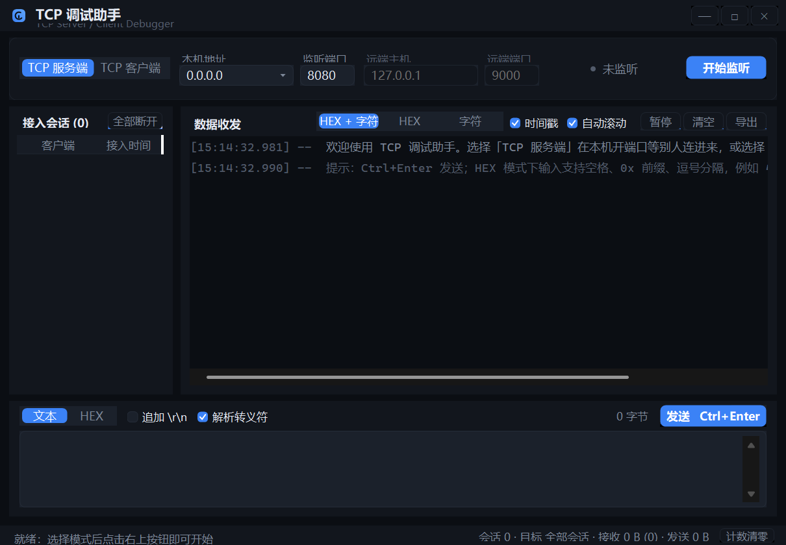

# TCP 调试助手

一个 Windows 桌面 TCP 调试工具，深色现代风界面，支持 TCP 服务端 / 客户端双模式与 HEX、ASCII 双向收发。单文件 exe，免安装 .NET 运行时。



## 功能

- **双模式**：TCP 服务端（多客户端接入、按会话单发或全局广播）／TCP 客户端（连接远端）
- **HEX / ASCII 双向收发**：HEX 输入容忍空格、`0x` 前缀、逗号、分号、连字符；显示支持「HEX + 字符」双栏、纯 HEX、纯字符三种视图
- **日志区**：时间戳前缀、收发分色、暂停刷新、清空、导出 txt；写入走队列 + 70 ms 批量刷新，高频收发不卡界面
- **状态栏**：会话数、发送目标、收发字节数与帧数统计，可清零
- **崩溃自诊断**：未处理异常自动落盘到 exe 同目录的 `crash.log`

未包含 UDP 与定时发送。

## 下载

到 [Releases](../../releases) 下载 `TcpDebugger.exe`，双击即可运行（自包含单文件，无需安装 .NET）。

## 从源码构建

需要 .NET 8 SDK（`net8.0-windows`，WinForms）：

```bash
dotnet build -c Release
```

自包含单文件发布：

```bash
dotnet publish -c Release -r win-x64 --self-contained true \
  -p:PublishSingleFile=true -p:IncludeNativeLibrariesForSelfExtract=true \
  -p:DebugType=none -o publish
```

## 自检

程序内置进程内自检，覆盖界面构造、多尺寸重排、角色切换、HEX／文本编解码、真实 TCP 回环与 64 KB 大包完整性，共 39 项，以退出码表达成败：

```bash
TcpDebugger.exe --selftest
```

全部通过时退出码为 0。

## 代码结构

```
Core/
  FrameCodec.cs         HEX / 文本编解码与转义解析
  IComService.cs        收发服务统一抽象
  TcpServerService.cs   TCP 服务端，多会话管理
  TcpClientService.cs   TCP 客户端
  SelfTest.cs           编解码与通信自检用例
UI/
  Theme.cs              深色配色与字体
  CardPanel.cs  FlatButton.cs  SegmentedControl.cs  CheckTile.cs
  TextField.cs  DropDown.cs  LabeledField.cs  StatusLed.cs
  LogBox.cs             日志区（队列 + 批量刷新）
  ClientListView.cs     会话列表
  DarkMenuRenderer.cs  WinApi.cs
MainForm.cs             业务逻辑
MainForm.UI.cs          界面搭建与自适应布局
MainForm.SelfTest.cs    界面自检用例
Program.cs              入口、崩溃日志、--selftest
```
